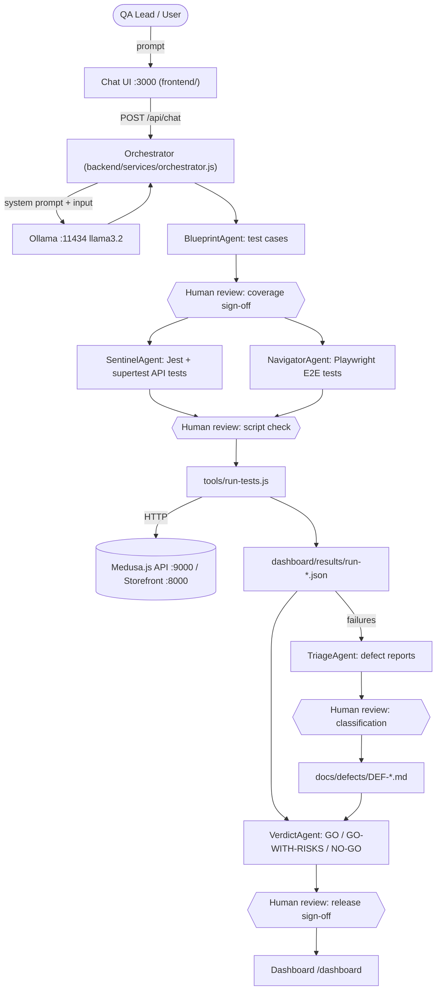

# Architecture Diagram — QA Agent Workflow

> **Deliverable 2 — BLAST Framework Architecture Documentation**  
> System: Local LLM QA Multi-Agent Orchestrator for Medusa.js eCommerce  
> Status: Active  

---

## 1. System Overview & ASCII Workflow Diagram

The system implements a local, privacy-preserving AI-driven QA automation hub adhering to the **BLAST Framework** (Blueprint → Link → Architect → Stylize → Trigger). The user interacts through a unified web interface on port 3000, which routes natural language intents through a centralized orchestrator to five specialized QA agents powered entirely by a locally hosted **Ollama** runtime (`llama3.2`).

```text
+---------------------------------------------------------------------------------------+
|                                    USER WORKSTATION                                   |
+---------------------------------------------------------------------------------------+
        |
        | 1. Submit QA Intent / Natural Language Prompt
        v
+---------------------------------------------------------------------------------------+
|  WEB INTERFACE (Port 3000)                                                            |
|  - Web Chat UI (/): Natural Language Agent Chat & Triggering                          |
|  - QA Dashboard (/dashboard): Chart.js Visualizations & Release Verdict Gates        |
+---------------------------------------------------------------------------------------+
        |
        | 2. HTTP POST /api/chat (or /api/results)
        v
+---------------------------------------------------------------------------------------+
|  AGENT ORCHESTRATOR (Express.js on Port 3000)                                         |
|  - Intent Detection & Routing (Keyword/Semantic Classifier)                           |
|  - System Prompt Interpolation & Schema Enforcement                                   |
|  - Human-in-the-Loop Approval Checkpoints                                            |
+---------------------------------------------------------------------------------------+
        |
        | 3. REST API: http://localhost:11434/api/generate
        v
+---------------------------------------------------------------------------------------+
|  LOCAL LLM ENGINE (Ollama on Port 11434)                                              |
|  - Model: llama3.2 (Deterministic inference, no external cloud dependencies)          |
+---------------------------------------------------------------------------------------+
        |
        | 4. Returns Specialized Instructions, Test Code & Triage Analysis
        v
+---------------------------------------------------------------------------------------+
|                                  THE 5 QA AGENTS                                      |
+---------------------------------------------------------------------------------------+
|  [Agent 1: BlueprintAgent]  --> Test Design, Scenarios & JSON Test Matrix             |
|  [Agent 2: SentinelAgent]   --> Jest + Supertest REST API Test Automation             |
|  [Agent 3: NavigatorAgent]  --> Playwright Browser E2E Automation                     |
|  [Agent 4: TriageAgent]     --> Log Analysis & Defect Origin Classification          |
|  [Agent 5: VerdictAgent]    --> Release Quality Gate Assessment & Go/No-Go Decision   |
+---------------------------------------------------------------------------------------+
        |
        | 5. Automated Execution Against System Under Test (SUT)
        v
+---------------------------------------------------------------------------------------+
|                         SYSTEM UNDER TEST: MEDUSA.JS ECOMMERCE                        |
+---------------------------------------------------------------------------------------+
|  - Storefront UI (Port 8000): Customer Login, Catalog, Cart Drawer, Checkout Funnel   |
|  - Core REST API (Port 9000): /store/auth, /store/products, /store/carts, orders      |
+---------------------------------------------------------------------------------------+
        |
        | 6. Test Results Aggregation & Defect Metrics
        v
+---------------------------------------------------------------------------------------+
|  REPORTING & VERDICT ENGINE                                                           |
|  - tools/run-tests.js aggregates Jest + Playwright results                            |
|  - Persists runs to dashboard/results/run-*.json                                      |
|  - Updates QA Dashboard (Pass/Fail bars, Pass Rate trendline, Defects table)          |
+---------------------------------------------------------------------------------------+
```

### 1.1 Agent Workflow (Mermaid — renders on GitHub)



---

## 2. Multi-Agent Role & Responsibility Matrix

| Agent Name | Primary Role | Inputs | Outputs | Tools Used | Human Review Point |
|------------|--------------|--------|---------|------------|--------------------|
| **BlueprintAgent** | Test Design Architect | PRD, user stories, Data Schema (`gemini.md`), business flows | Structured test matrix (JSON) covering positive, negative, and boundary scenarios | Ollama REST API (`/api/generate`), schema validator | **Pre-Generation Gate:** Review & sign off on test case coverage and schema compliance before generating test code |
| **SentinelAgent** | API Testing Specialist | Blueprint test cases, Medusa API endpoints (`/store/*`) | Executable Jest + supertest test suites (`tests/api/*.test.js`) | Jest, supertest, Node.js `child_process`, Ollama API | **Pre-Execution Gate:** Inspect generated HTTP assertion code, mock assertions, and endpoint payloads |
| **NavigatorAgent** | UI/E2E Automation Engineer | Customer journeys (Login → Browse → Cart → Checkout) | Playwright test scripts (`tests/e2e/*.spec.js`), failure screenshots | Playwright test runner, Chromium, Ollama API | **Script Gate:** Verify selector resilience (roles vs. CSS) and ensure appropriate wait strategies |
| **TriageAgent** | Failure Classification Expert | Test failure logs, stack traces, HTTP status codes, error screenshots | Structured defect reports (Classification, Severity, Root Cause, Remediation) | Log analyzer, diff parser, Ollama API | **Triage Gate:** Validate defect classification (`PRODUCT_BUG` vs `TEST_ISSUE` vs `ENVIRONMENT_ISSUE`) |
| **VerdictAgent** | Release Quality Gatekeeper | Sentinel test metrics, Navigator test metrics, open defect list | Authoritative release decision (`GO`, `GO-WITH-RISKS`, `NO-GO`) with reasoning | Dashboard API, Chart.js reporting engine | **Final Release Sign-off:** Engineering lead confirms production deployment suitability |

---

## 3. Repository File Structure

```text
project6/
├── frontend/                 # Chat UI (index.html, style.css, app.js)
├── backend/                  # Express server :3000
│   ├── server.js
│   ├── agents/templates.js   # 5 agent system prompts + trigger keywords
│   ├── services/             # ollama.js, orchestrator.js
│   ├── routes/               # chat.js, results.js
│   └── .env.example
├── dashboard/
│   ├── index.html            # Chart.js dashboard
│   └── results/              # run-001.json, run-002.json (sample data)
├── tests/
│   ├── api/                  # auth, products, cart, checkout (+ setup.js) — 32 tests
│   ├── e2e/                  # auth, shop, cart, checkout specs — 21 tests
│   └── playwright.config.js
├── tools/run-tests.js        # Runs suites, writes results JSON
├── docs/
│   ├── architecture.md       # Deliverable 2
│   ├── test_strategy.md      # Deliverable 3
│   ├── test_cases.md         # Deliverable 4
│   ├── defects/DEF-00x.md    # Deliverable 4 (sample defect reports)
│   └── ai_evaluation.md      # Deliverable 6
├── BLAST.md, gemini.md, task_plan.md, findings.md, progress.md
└── README.md                 # Deliverable 1
```

---

## 4. End-to-End Data Flow

1. **User Request Intake:**  
   The user enters a command or inquiry via the Web Chat UI (`http://localhost:3000/`).
2. **Intent Classification & Agent Dispatch:**  
   `server.js` passes the prompt to `detectAgent(message)` in `backend/agents/templates.js`. The dispatcher matches trigger keywords to identify whether the task belongs to `BlueprintAgent`, `SentinelAgent`, `NavigatorAgent`, `TriageAgent`, or `VerdictAgent`.
3. **Local LLM Prompt Construction:**  
   The orchestrator extracts the agent's system prompt from `templates.js`, incorporates conversation history, and invokes the local Ollama daemon at `http://localhost:11434/api/generate` using the `llama3.2` model.
4. **Execution & Automation Trigger:**  
   - Generated test cases are reviewed.
   - Sentinel and Navigator suites execute against the running Medusa.js backend (`:9000`) and storefront (`:8000`).
   - `tools/run-tests.js` triggers tests via `execSync`, reads stdout/coverage summaries, and evaluates results.
5. **Defect Triage & Root Cause Analysis:**  
   Any assertion failures are channeled into `TriageAgent` to determine whether the failure represents an application bug, test script issue, or environment outage.
6. **Verdict & Dashboard Presentation:**  
   `VerdictAgent` assesses pass rates and defect severity thresholds to calculate a `GO`, `GO-WITH-RISKS`, or `NO-GO` verdict. Results are saved to `dashboard/results/` and surfaced in the browser dashboard (`http://localhost:3000/dashboard`).

---

## 5. Network & Port Mapping Table

| Port | Service Name | Protocol | Purpose / Description |
|------|--------------|----------|-----------------------|
| **3000** | Web App & Dashboard | HTTP | Express application hosting the Chat UI, serving the QA dashboard, and handling `/api/*` endpoints |
| **8000** | Medusa Storefront | HTTP | Next.js/Gatsby eCommerce storefront SUT where Playwright runs UI flows |
| **9000** | Medusa Backend Server | HTTP | Headless commerce REST API engine handling authentication, cart sessions, catalog, and checkout |
| **11434** | Ollama LLM Service | HTTP | Local AI inference daemon hosting `llama3.2` with zero external network connectivity |

---

## 6. Technology Stack & Component Inventory

| Layer | Technology | Version / Spec | Justification |
|-------|------------|----------------|---------------|
| **Application Runtime** | Node.js | v18.0.0+ | Modern LTS runtime supporting native fetch, ES modules, and async operations |
| **Backend Framework** | Express.js | ^4.18.2 | Lightweight, unopinionated web server for chat UI and REST API routing |
| **Local LLM Engine** | Ollama | Latest CLI | High-speed, local LLM execution engine ensuring 100% data privacy and zero API costs |
| **LLM Model** | Llama 3.2 | 3B Parameter | Optimized for structured instruction-following, code generation, and low-latency local inference |
| **API Test Runner** | Jest + Supertest | Latest | Standard Node.js assertion library and HTTP integration test runner |
| **UI/E2E Test Runner** | Playwright | ^1.40.0+ | Fast, cross-browser automation with auto-waiting, tracing, and screenshot capture |
| **Dashboard UI** | HTML5 / CSS3 / Vanilla JS | Browser native | Zero-overhead, dark-mode responsive dashboard served directly from Express |
| **Visual Charting** | Chart.js | v4.x (CDN) | Lightweight, accessible canvas charting for breakdown bars and pass rate trends |
| **System Under Test (SUT)** | Medusa.js | v1.x / v2.x | Modular open-source headless eCommerce platform with rich REST API and active community |
